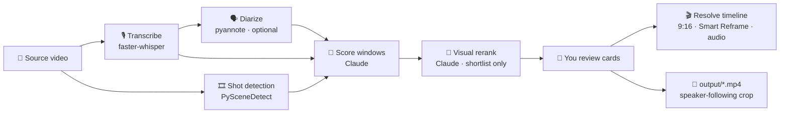

<div align="center">

# ✂️ Clippers

### Long video in. Scroll-stopping Shorts out. Straight onto your DaVinci Resolve timeline.

Clippers finds the moments in a talk, sermon, podcast or interview that work on their own as a short clip. It ranks them on hook, payoff, loudness and visuals, re-cuts them so they open clean, and frames the speaker in 9:16. Your picks land in DaVinci Resolve as a timeline that's ready to edit.


[](https://github.com/aadedolapo/Clippers/actions/workflows/ci.yml)


[Quick start](#-quick-start) · [How it works](#-how-it-works) · [Using it](#%EF%B8%8F-using-it) · [Daily workflow](#-daily-workflow) · [Configuration](#%EF%B8%8F-configuration) · [Troubleshooting](#-troubleshooting) · [Contributing](#-contributing)

</div>

---

## ✨ What it does

|  |  |
|---|---|
| 🎯 **Finds the clips** | Transcribes the video with faster-whisper. Claude then scores overlapping windows for hook strength, payoff, standalone sense, lane fit and loopability. |
| 👀 **Looks at the frames** | The shortlist gets a *visual rerank*: Claude sees the first frame, hook, middle, payoff and last frame. Black frames, slides and the back of someone's head lose. |
| ✂️ **Cuts clean** | Starts and ends snap to transcript segments *and* camera cuts, so no clip opens on a one-frame flash of the previous shot. |
| 🧑 **Follows the speaker** | Rendered clips track the speaker's face with smoothing and a dead zone. They hard-cut instead of panning when the focus moves to someone else. If diarization is on, the crop follows whoever is talking. |
| 🎬 **Builds your timeline** | One click sends picks to Resolve: trimmed, zoomed to fill 9:16, Smart Reframed, with a music bed and whoosh on their own audio tracks. |
| 📱 **Works without Resolve** | Every clip is also rendered as a ready-to-post mp4. If Resolve isn't there, you still get the mp4 to post or finish in any editor (Premiere, Final Cut, CapCut…). |
| 📈 **Learns from results** | Log stayed-to-watch % after posting. The scorer feeds the best and worst hooks back into itself, and an eval script tells you whether a change helped. |

> [!NOTE]
> Clippers is a **single-user local tool**. One Python server and one browser tab run on your machine and talk to the DaVinci Resolve open on that same machine, if there is one. It has no hosting, no auth and no database.

---

## 🚀 Quick start

### Requirements

| | |
|---|---|
| 🐍 **Python 3.9–3.13** | pipx can fetch 3.13 for you (see Install) |
| 🎞️ **[ffmpeg](https://ffmpeg.org/)** | on your `PATH` |
| 🎬 **DaVinci Resolve** *(optional)* | open **with a project loaded**. Studio adds AI Smart Reframe; the free version gets a static pan instead. Without Resolve you get the mp4s only. |
| 🔑 **[Anthropic API key](https://console.anthropic.com/)** | for scoring and the visual rerank |
| 📼 **A source video file** | You bring the file: your own footage, or a downloader such as [Cobalt](https://cobalt.tools) or 4K Video Downloader. |

### Install

```bash
pipx install --python 3.13 --fetch-missing-python git+https://github.com/aadedolapo/Clippers.git
```

[pipx](https://pipx.pypa.io/) (`brew install pipx` on macOS) installs Clippers in its own environment and puts the `clippers` command on your path. Clippers runs on **Python 3.9–3.13**: the transcription engine doesn't support newer versions yet. `--python 3.13 --fetch-missing-python` makes pipx use 3.13, downloading it if you don't have it, even when your default Python is newer.

For speaker diarization, add the extra (it pulls in PyTorch, several GB):

```bash
pipx install --python 3.13 --fetch-missing-python "clippers[diarization] @ git+https://github.com/aadedolapo/Clippers.git"
```

### Set up

```bash
clippers init      # creates ~/Clippers and ~/Clippers/.env
```

Put your key in `~/Clippers/.env`, and tell it what your channel is about (optional, see [Your channel](#-your-channel)):

```ini
ANTHROPIC_API_KEY=sk-ant-...
CHANNEL_DESCRIPTION=a faith and self-improvement channel for young men
CHANNEL_LANES=faith, men's growth, discipline, purpose
```

Then check everything is in place:

```bash
clippers doctor
```

If you use Resolve, turn on scripting once: **Preferences → System → General → External scripting using: Local**.

### Run

1. If you're using Resolve, open it and load a project.
2. Start the app:

   ```bash
   clippers serve
   ```

3. Open **http://localhost:8000** in your browser.

That one command runs everything. Leave the terminal open while you work, and press **Ctrl + C** to stop it. Use `clippers serve --port 8001` if port 8000 is taken.

### Commands

| Command | What it does |
|---|---|
| `clippers init` | Create the home folder and a `.env` to fill in |
| `clippers serve` | Start the app (`--host`, `--port`) |
| `clippers doctor` | Check ffmpeg, the API key, Resolve and the optional extras |
| `clippers report` | Posted-clip performance by lane, duration and cold open |
| `clippers eval` | Score-vs-retention eval (see [Measuring the scorer](#-measuring-the-scorer)) |

### Updating

```bash
pipx reinstall --python 3.13 --fetch-missing-python clippers
```

This installs the latest version from GitHub. Keep the `--python 3.13` part: without it pipx uses your default Python, which may be too new. Your settings, clips and history in `~/Clippers` aren't touched.

---

## 🧭 How it works



<details>
<summary><b>How a clip gets its score</b></summary>

<br/>

Each candidate gets a scorecard from Claude, plus two measured signals. They're combined with the weights in `src/clippers/scoring.py`:

| Signal | Weight | Source |
|---|:---:|---|
| **Hook pass**: would the first line stop a scroll? | `0.315` | Claude (pass/fail) |
| **Payoff**: does it land? | `0.18` | Claude (0–10) |
| **Standalone**: does it make sense with no context? | `0.135` | Claude (0–10) |
| **Lane fit**: does it match your channel's topics? | `0.135` | Claude (0–10) |
| **Visual**: first-frame strength and visual energy | `0.10` | Claude, from frames |
| **Loopability**: does the ending flow back into the start? | `0.09` | Claude (0–10) |
| **Audio energy**: loudness and dynamics | `0.045` | librosa |

The visual rerank only runs on the shortlist, which is twice as many clips as you'll see. Every other candidate counts as neutral (0.5) for visuals, so it's neither helped nor hurt.

</details>

<details>
<summary><b>Shot snapping</b></summary>

<br/>

Camera cuts are detected once per video and cached as `<video>.shots.json`. Detection runs alongside transcription, so it adds no wait.

- A cut **≤ 0.5s before** the start → the clip opens on the cut.
- A cut **≤ 0.5s after** the start, with no speech before it → the silence is trimmed and the clip opens on the cut.
- If the speaker has already started talking → the clip backs off to an earlier cut within 1.5s, or opens on the cut anyway. Losing a sliver of a word is better than a flash frame.
- A cut in the **last 0.15s** → the clip ends on the cut.

</details>

<details>
<summary><b>Speaker-following crop</b></summary>

<br/>

The `output/` mp4 samples 5 frames a second and finds faces with OpenCV's YuNet. The model is downloaded once to `~/Clippers/models/`. The camera path is smoothed in these ways:

- a **dead zone**, so small head movements don't move the frame;
- an **EMA and moving average**, so moves are gentle;
- a **hard cut** instead of a whip-pan when the target jumps to another person and stays there.

The path drives ffmpeg's `crop` filter frame by frame. If no face is found, the clip is center-cropped. Untick **Follow speaker** on a clip to force the center crop.

In Resolve, **Studio** uses Smart Reframe. **Free** Resolve gets a static pan to where the speaker mostly stands, because the scripting API can't set keyframes.

</details>

<details>
<summary><b>Speaker diarization (optional)</b></summary>

<br/>

If you add a Hugging Face token, pyannote labels who says what. The scorer sees lines like `(SPEAKER_01)`. When two people are on screen, the crop follows whoever is talking, chosen by mouth movement.

1. Accept the model terms for [speaker-diarization-3.1](https://huggingface.co/pyannote/speaker-diarization-3.1) and [segmentation-3.0](https://huggingface.co/pyannote/segmentation-3.0).
2. Install the extra: `pipx install --python 3.13 --fetch-missing-python "clippers[diarization] @ git+https://github.com/aadedolapo/Clippers.git"` (or `pip install -e ".[diarization]"` in a checkout).
3. Set `HF_TOKEN=` in `~/Clippers/.env`.

It's slow on CPU: several minutes per hour of audio. Results are cached as `<video>.diarization.json`. Without a token, everything runs exactly as before.

</details>

---

## 🖱️ Using it

1. **Upload.** Pick one or more videos in the browser. With a single file you can also give it a title and where it's from (channel, church, speaker). Several files queue up and are analyzed two at a time.
2. **Choose a length.** Leave it on Shorts (15–45s), or tick **Long-form clips** for 45–90s story clips.
3. **Analyze.** It transcribes, finds camera cuts, scores and reranks. This takes a few minutes, depending on video length. If it fails, click **Retry** on its card (see [Jobs survive restarts](#-jobs-survive-restarts)).
4. **Review the cards.** Each card shows:
   - a portrait preview player that plays just that clip;
   - the time range and length;
   - the score, with a one-line reason;
   - the visual verdict;
   - a generated **hook** line with a **Copy** button, for your title overlay in Resolve;
   - the transcript.
5. **Set up each clip** you want:

   | Control | What it does |
   |---|---|
   | **Clip style** | Minimal Faith (zoom-out opener, optional B&W, music bed) or Plain |
   | **Cold open** | Flash-forwards the clip's strongest line to the very start (Plain only) |
   | **Spoken outro** | A short narrated close after the clip (needs `ELEVENLABS_API_KEY`) |
   | **Burn captions** | Burns captions into the mp4 (the timeline never gets them) |
   | **Follow speaker** | Speaker-tracking crop. Untick it for a center crop. |
   | **Aspect** | 9:16, 4:5 or 1:1 for the mp4 |
   | **B-roll** / **Beat plan** | On-demand Pexels B-roll suggestions and an editorial beat map |

6. **Send to Resolve.** For each clip, the backend:
   - imports the source into the media pool (once per video);
   - creates or reuses a 9:16 timeline named `Viral Clips - <title>`;
   - appends the trimmed clip, zoomed to fill, and Smart Reframes it;
   - adds the music bed (A2) and the whoosh (A3) as real audio tracks;
   - renders a separate **ready-to-post mp4** into `~/Clippers/output/`.

   **No Resolve? Still click Send to Resolve.** If Resolve isn't installed, isn't open, or doesn't allow scripting (which may be the case on the free version), the clip is rendered as an mp4 anyway. Its card shows a yellow note with the file path, and you can finish the edit in any editor. The mp4 has the reframe, style effects, music, captions (if ticked), cold open and outro baked in. B-roll is the one thing that only goes on the Resolve timeline.
7. **Switch to Resolve.** Review, tighten and export. For native, editable captions, drag in your animated subtitle template (Effects Library → Titles → Subtitles) once per timeline.

Every analyzed video stays on the page after a refresh or restart, with its clips, so you can come back and send more later.

---

## 📅 Daily workflow

The retention data points at one bottleneck: **viewers swipe away in the first second.** The fix is to **make lots of candidates and post very few.**

```text
 3–4 videos ──▶ analyze all ──▶ watch the top clips ──▶ gut-check top 2 ──▶ post 1–2/day ──▶ log stats at 48h
```

1. **Pick 3–4 source videos** that fit your channel's lanes. Prefer speakers who haven't been clipped much.
2. **Analyze all of them.** Each video's cards are ranked by score, and anything that fails the hook check is already dropped.
3. **Gut-check the top 2.** Play them on their cards. Does the first second make *you* stop?
4. **Send to Resolve, finish, post 1–2 a day**, a few hours apart.
5. **After 48h**, click **Mark as posted** and log stayed-to-watch % and views. You can also send a YouTube Studio CSV (Content → Shorts → Export) to `POST /performance/import-csv` each week.
6. **Every 2 weeks**, run `clippers report` and tune `WEIGHTS` in `scoring.py`. Once you have 10+ posted clips with stats, the scorer uses your best and worst hooks as examples automatically.

---

## 💾 Jobs survive restarts

Every analysis job is saved to `~/Clippers/data/jobs/<job_id>.json`. After a restart, **Send to Resolve, B-roll and beat plans keep working** on anything you analyzed before. If an analysis fails, or is cut off by a restart, it shows on the main page with **Retry** and **Dismiss** buttons. Retry runs the analysis again on the same video with the same settings: the transcript and Claude scoring run again, while camera cuts and speaker turns come from cache. Dismiss hides it. Analyses still running when you refresh the page reappear and keep updating.

---

## 🩺 Troubleshooting

| Problem | Fix |
|---|---|
| Not sure what's wrong | Run `clippers doctor`. It checks ffmpeg, your API key, the home folder and Resolve. |
| `address already in use` when starting | Something else is on port 8000. Use `clippers serve --port 8001`, or stop the other server (macOS/Linux: `lsof -ti:8000 \| xargs kill`). |
| Yellow *Not sent to Resolve* note on a clip | The mp4 was still rendered, at the path shown. To get the timeline too, open Resolve with a project loaded, check **External scripting using: Local** in Preferences → System → General, and send again. |
| *Could not import DaVinciResolveScript* | Resolve's scripting files aren't in the standard place for your OS. Reinstall Resolve, or check the paths in `resolve_integration.py`. |
| Clips in Resolve aren't Smart Reframed | Smart Reframe needs Resolve **Studio**. Free Resolve gets a static pan instead. |
| *Interrupted* on a video card | The server stopped mid-analysis. Click **Retry**. |
| No whoosh or music | `SFX_DIR` / `MUSIC_DIRS` aren't set or point at empty folders. Both skip silently. |
| The speaker crop sits in the middle | No face was found (wide shot, slides, back of head), so it fell back to a center crop. |
| Analysis is slow | Transcription runs on the CPU. A smaller `WHISPER_MODEL_SIZE` (`base`, `tiny`) is faster but less accurate. Diarization adds several minutes per hour of audio. |

---

## ⚙️ Configuration

Settings live in `~/Clippers/.env` (created by `clippers init`). A `.env` in the folder you run `clippers` from is read first, and real environment variables beat both. Only `ANTHROPIC_API_KEY` is required; every other feature skips itself if it isn't configured.

### 📺 Your channel

Two settings tune the scorer and the commentary to your channel:

```ini
CHANNEL_DESCRIPTION=a faith and self-improvement channel for young men
CHANNEL_LANES=faith, men's growth, discipline, purpose
```

**Lanes** are your channel's core topics. Claude rates how well each clip fits them (the *lane fit* score) and tags it with one, and the `/shortlist` endpoint takes at most one clip per lane so its top picks aren't all the same topic. Leave both empty for a general-purpose channel: clips are then rated on broad appeal and tagged with a free-form topic.

<details open>
<summary><b>Core</b></summary>

| Variable | Default | Purpose |
|---|---|---|
| `ANTHROPIC_API_KEY` | — | **Required.** Claude API key |
| `CLIPPERS_HOME` | `~/Clippers` | Where data, output and `.env` live (set it in your shell, not in that `.env`) |
| `CHANNEL_DESCRIPTION` | — | What the channel is about |
| `CHANNEL_LANES` | — | Comma-separated core topics |
| `WHISPER_MODEL_SIZE` | `small` | faster-whisper model size |

</details>

<details>
<summary><b>Models</b></summary>

| Variable | Default | Used for |
|---|---|---|
| `CLAUDE_SCORING_MODEL` | `claude-sonnet-5` | Window scoring |
| `CLAUDE_VISUAL_MODEL` | `claude-opus-5-5` | Visual rerank |
| `CLAUDE_COMMENTARY_MODEL` | `claude-sonnet-5` | Commentary / outro scripts |
| `CLAUDE_BROLL_QUERY_MODEL` | `claude-sonnet-5` | B-roll search queries |
| `CLAUDE_BEAT_PLAN_MODEL` | `claude-sonnet-5` | Beat plans |

</details>

<details>
<summary><b>Clip lengths</b></summary>

| Variable | Shorts | Variable | Long-form |
|---|:---:|---|:---:|
| `CLIP_MIN_SECONDS` | 15 | `LONG_CLIP_MIN_SECONDS` | 45 |
| `CLIP_MAX_SECONDS` | 45 | `LONG_CLIP_MAX_SECONDS` | 90 |
| `CLIP_TARGET_MIN_SECONDS` | 20 | `LONG_CLIP_TARGET_MIN_SECONDS` | 60 |
| `CLIP_TARGET_MAX_SECONDS` | 35 | `LONG_CLIP_TARGET_MAX_SECONDS` | 75 |

</details>

<details>
<summary><b>Optional features</b></summary>

| Variable | Default | Purpose |
|---|---|---|
| `VISUAL_RERANK` | `1` | Set to `0` to skip the frame-based rerank |
| `HF_TOKEN` | — | Turns on speaker diarization (pyannote) |
| `DIARIZATION` | `1` | Set to `0` to skip diarization even with a token |
| `PEXELS_API_KEY` | — | B-roll suggestions |
| `ELEVENLABS_API_KEY` | — | Narrated outro (TTS) |
| `ELEVENLABS_VOICE_ID` | Brian | Narration voice |
| `MUSIC_DIRS` | — | Music beds by mood, e.g. `slow=~/Music/slow,cinematic=~/Music/cinematic` |
| `SFX_DIR` | — | Folder with whoosh, riser and impact SFX (e.g. Resolve's Sound Library) |

</details>

### 🎵 Music & SFX

- **Music beds** are picked at random by mood from your own library, skipping the last 5 used. They're mixed at about −28 LUFS under the voice at −15 LUFS, and sidechain-ducked whenever the speaker talks.
- **Whoosh** plays on the zoom-out opener. `SFX_DIR` is indexed once into `~/Clippers/data/sfx_index.json`. Delete that file to re-index after adding sounds.

### 🔤 Captions

Captions are **off by default**, so you can use your own animated template in Resolve. Tick **Burn captions** on a clip to burn them into its mp4:

- **Minimal Faith** gets phrase captions.
- **Plain** gets word-by-word karaoke captions.

Fonts, colors and timings are in `src/clippers/captions.py`. The bundled fonts are Montserrat and Playfair Display, both under the SIL Open Font License.

---

## 📏 Measuring the scorer

Run this before and after any change to `WEIGHTS` or the scoring prompt. It checks that the scorer still ranks the clips that **actually held viewers** higher.

```bash
clippers eval export                     # posted clips with stayed % → ~/Clippers/eval/clips.json
clippers eval --weights-only             # re-weight stored scorecards (free, instant)
clippers eval --note "what I changed"    # re-score with the current prompt (API calls)
clippers eval --visual                   # …including the visual rerank
```

Each run prints the **Spearman correlation** between score and stayed-to-watch %, overall and per lane and duration bucket. It appends the result, the version, the git commit and the weights to `~/Clippers/eval/results.jsonl`, so you can compare runs over time.

### 🔌 API

The page talks to these endpoints, so you can script against them too.

| Endpoint | What it does |
|---|---|
| `POST /upload` | Save a video into `~/Clippers/downloads/` |
| `POST /analyze` | Start an analysis (`local_file` or `url`, optional `title`, `source`, `long_form`) |
| `GET /status/<job_id>` | Progress, then clips when done |
| `GET /jobs` | Every job, including restored ones |
| `POST /jobs/<job_id>/retry` · `/dismiss` | Re-run or hide a failed job |
| `GET /saved-clips` | Every analyzed video and its clips |
| `GET /video/<video_id>` | Stream a video's source file (the clip preview players use it) |
| `GET /shortlist?date=YYYY-MM-DD` | The day's best clips across videos, at most one per lane |
| `POST /send-to-resolve` | Render mp4s and put clips on the Resolve timeline (each result has `in_resolve` and, if Resolve wasn't reached, `resolve_error`) |
| `POST /broll/<video_id>/<i>` · `/beat-plan/<video_id>/<i>` | B-roll suggestions and beat plan for one clip |
| `POST /performance` · `/performance/import-csv` | Log stats for a posted clip, or import a Studio CSV |

### 🧪 Development

```bash
git clone https://github.com/aadedolapo/Clippers.git && cd Clippers
python3.13 -m venv venv && source venv/bin/activate   # any Python 3.9–3.13
pip install -e ".[dev]"
ruff check src tests && pytest
```

Tests run against a throwaway home folder, so they never touch your clips. See [CONTRIBUTING.md](CONTRIBUTING.md) for more.

---

## 🗂️ Project layout

```text
Clippers/
├── src/clippers/
│   ├── cli.py                  the `clippers` command
│   ├── server.py               FastAPI app, job queue, all endpoints
│   ├── paths.py                where data lives (~/Clippers or CLIPPERS_HOME)
│   ├── channel.py              channel description and lanes
│   ├── pipeline.py             download + faster-whisper transcription
│   ├── llm_scoring.py          Claude window scoring, clip-length presets
│   ├── scoring.py              WEIGHTS, combined score, shortlist + pick
│   ├── visual_rerank.py        frame-based Claude rerank
│   ├── shots.py                camera-cut detection and snapping
│   ├── diarize.py              pyannote speaker turns (optional)
│   ├── reframe.py              face tracking → smooth crop path
│   ├── resolve_integration.py  timelines, Smart Reframe, audio tracks
│   ├── captions.py             caption styles and renders
│   ├── commentary*.py, tts.py  commentary, cold open, spoken outro
│   ├── broll.py, beat_plan.py  B-roll suggestions, editorial beats
│   ├── music.py, sfx.py        music beds and SFX library
│   ├── performance.py          posted-clip stats + report
│   ├── jobs_store.py           durable jobs on disk
│   ├── evaluate.py             score-vs-retention eval
│   ├── static/index.html       the app (one file, no build step)
│   └── assets/                 bundled fonts, .env template
├── tests/                      pytest suite
└── pyproject.toml
```

### Where things end up

| What | Where |
|---|---|
| Settings | `~/Clippers/.env` |
| Uploaded source videos | `~/Clippers/downloads/` |
| Camera cuts and speaker turns per video | `~/Clippers/downloads/<video>.shots.json`, `.diarization.json` |
| Analysis jobs (transcript, candidates) | `~/Clippers/data/jobs/<job_id>.json` |
| Saved clip metadata (hook, title, scorecard) | `~/Clippers/data/saved_clips.json` |
| Posted-clip performance log | `~/Clippers/data/performance.json` |
| Music history and SFX index | `~/Clippers/data/music_history.json`, `sfx_index.json` |
| Face-detection model | `~/Clippers/models/` |
| Ready-to-post clips | `~/Clippers/output/` |
| Resolve timelines | your open project, as `Viral Clips - <title>` |
| Eval set and results | `~/Clippers/eval/clips.json`, `results.jsonl` |

Set `CLIPPERS_HOME` to keep all of it somewhere else.

---

## 📝 Notes

- **For the Resolve timeline, Resolve must be open with a project loaded** before you click Send to Resolve. Without it you get the mp4 only.
- **Cost scales with video length.** Scoring runs several Claude calls at once. The visual rerank adds one call per shortlisted clip.
- The **Resolve timeline is always 9:16**. The aspect picker only changes the mp4.
- **B-roll and beat plans are on demand**, one Claude call per click. They never run automatically.

---

## ⚖️ Responsible use

Clippers cuts clips from other people's videos. You're responsible for having the rights to what you clip and post: your own footage, footage you have permission to use, or use that's allowed where you post it. Clippers doesn't check this for you, so clear each source before you post from it.

## 🤝 Contributing

Issues and pull requests are welcome. See [CONTRIBUTING.md](CONTRIBUTING.md) for setup and checks, and [CHANGELOG.md](CHANGELOG.md) for what's changed.

## 📄 License

[MIT](LICENSE). The bundled Montserrat and Playfair Display fonts are under the [SIL Open Font License](src/clippers/assets/fonts/).

<div align="center">
<br/>
<sub>Built for one creator, one machine, one great clip at a time. ✂️</sub>
</div>
